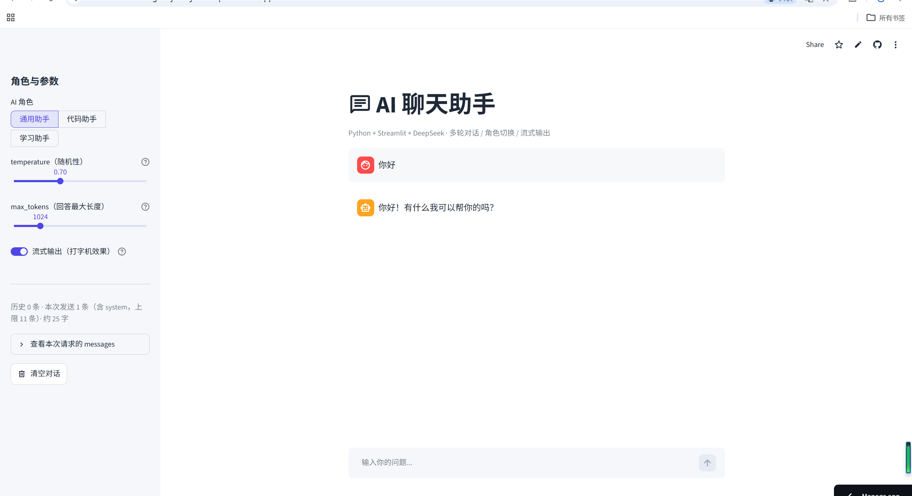

# AI 聊天助手（DeepSeek + Streamlit）

基于 DeepSeek API 的网页版 AI 聊天助手：支持多轮对话记忆、角色切换（System Prompt）、
temperature / max_tokens 参数调节，以及打字机式流式输出。这是 24 周学习计划的**作品集项目 1**。

> 在线 Demo：`https://<你的应用名>.streamlit.app`

## 功能特性

- **多轮对话记忆**：用 `st.session_state` 维护 messages 列表，每次请求携带历史上下文
- **角色切换**：内置「通用 / 代码 / 学习」三种 System Prompt，一键切换
- **参数调节**：`temperature`（随机性）与 `max_tokens`（回答长度）实时可调
- **流式输出**：打字机效果，边生成边显示，并可在侧边栏开关对比
- **上下文管理**：简单截断，防止历史无限增长；侧边栏实时显示本次发送的消息数/字数
- **异常处理**：超时、断网、401、429 限流等都有中文友好提示
- **密钥安全**：不硬编码，本地读 `st.secrets` / 环境变量，线上读平台 Secrets

## 技术栈

| 分类 | 技术 |
| --- | --- |
| 语言 | Python 3.11 |
| Web 框架 | Streamlit |
| 大模型 | DeepSeek Chat API（OpenAI 兼容接口） |
| HTTP | requests（含 SSE 流式解析） |
| 部署 | Streamlit Community Cloud |

## 界面截图

<!-- 把截图放到 screenshots/ 目录，然后替换下面的路径 -->



## 项目结构

```
.
├── app.py                  # 网页版入口（Streamlit，主程序）
├── main.py                 # 控制台版入口（最早的原型）
├── requirements.txt        # 依赖清单
├── .streamlit/
│   ├── config.toml         # 主题配置
│   └── secrets.toml        # 本地密钥（已 gitignore，不要提交）
├── screenshots/            # 界面截图
└── README.md
```

## 本地运行

1. 创建并激活虚拟环境，安装依赖：

   ```powershell
   python -m venv venv
   venv\Scripts\activate
   pip install -r requirements.txt
   ```

2. 配置密钥，二选一：

   - `.streamlit/secrets.toml`：
     ```toml
     DEEPSEEK_API_KEY = "你的密钥"
     ```
   - 或环境变量 `DEEPSEEK_API_KEY`

3. 启动网页版（在项目根目录执行）：

   ```powershell
   streamlit run app.py
   ```

   浏览器打开终端提示的 `http://localhost:8501`。

   控制台版：

   ```powershell
   python main.py
   ```

> 不要用 `python app.py` 启动网页版，否则只会刷 `missing ScriptRunContext` 警告，页面起不来。

## 部署到 Streamlit Community Cloud（免费）

1. 把本仓库推送到 GitHub（公开或私有均可）：
   ```powershell
   git add .
   git commit -m "update"
   git push origin main
   ```
2. 打开 https://share.streamlit.io ，用 **GitHub 账号登录**并授权。
3. 点 **Create app → Deploy a public app from GitHub**，填写：
   - **Repository**：`<你的GitHub用户名>/<仓库名>`
   - **Branch**：`main`
   - **Main file path**：`app.py`
4. 点 **Advanced settings → Secrets**，粘贴（用你自己的 Key）：
   ```toml
   DEEPSEEK_API_KEY = "你的密钥"
   ```
5. 点 **Deploy**，等待几分钟，得到公网链接 `https://<应用名>.streamlit.app`。

**注意**：

- 不要把 `secrets.toml` 或 `.env` 上传到仓库，线上只用平台的 Secrets。
- 免费版闲置一段时间会休眠，有人访问时自动唤醒（首次加载可能要几十秒），属正常现象。
- 应用依赖 `requirements.txt` 自动安装；入口文件是根目录的 `app.py`。

### 为什么不用 HuggingFace Spaces？

早期计划是部署到 HuggingFace Spaces，但当前 HF 免费套餐只开放 **Static** 类型空间
（Gradio / Docker / Streamlit 需要付费 PRO），而 Static 无法运行 Python/Streamlit，
也不能配置 Secrets（页面提示 *"Secrets are not available for static Spaces"*）。
因此改用 Streamlit 官方的 Community Cloud，免费且专为 Streamlit 设计。

## 踩坑总结

1. **API Key 泄露**：最早的控制台版本把密钥硬编码进了 `main.py` 并提交到了 Git。
   即使后来删除，**历史提交里仍然存在**。正确做法是从一开始就用环境变量 / Secrets，
   并且一旦泄露要立刻在平台后台作废重签。（`.gitignore` 已加入 `.env` 和 `secrets.toml`）
2. **启动方式错误**：用 `python app.py` 跑 Streamlit 只会刷 `missing ScriptRunContext` 警告，
   必须用 `streamlit run app.py`。
3. **Streamlit 无状态**：脚本每次交互都会从头重跑，聊天记录必须放 `st.session_state`，
   普通变量会被重置。
4. **流式中文乱码**：`iter_lines(decode_unicode=True)` 可能按 latin-1 解码，导致中文乱码，
   改为读取原始字节后手动 `decode("utf-8")`。
5. **流式超时判定**：流式不能用单个超时值，要用元组 `(连接超时, 读取超时)`，
   否则生成时间长会被误判超时。
6. **流式异常发生在中途**：HTTP 200 之后仍可能因限流/断网中断，必须用 `try/except` 包住
   `st.write_stream(...)`，失败时回滚那条提问，避免留下「有问题没回答」的悬空消息。
7. **上下文无限增长**：每轮都带全部历史，越聊越贵越慢，用 `history[-N:]` 简单截断；
   代价是早期信息丢失。
8. **配置密钥读取顺序**：本地 `.streamlit/secrets.toml`、线上 `st.secrets`、环境变量要分层兜底，
   便于本地和部署环境复用同一份代码。

---

# 附录：学习笔记（第 4、5 周）

## 第 4 周：多轮对话记忆

### messages 列表结构

```python
[
  {"role": "system",    "content": 角色设定},   # 每次请求都加
  {"role": "user",      "content": 第1轮提问},
  {"role": "assistant", "content": 第1轮回答},
  {"role": "user",      "content": 第2轮提问},  # 最新
]
```

构造逻辑在 `build_request_messages()`（`app.py`）：

```python
recent_history = history[-MAX_HISTORY_MESSAGES:]
return [{"role": "system", "content": system_prompt}, *recent_history]
```

大模型本身没有记忆，API 是无状态的；「多轮对话」是每次把历史重新发过去实现的。

### 实验一：让 AI「失忆」

1. 连续问 3 轮，如「我叫小明」「我喜欢 Python」「我第一句说了什么？」——它能答上来。
2. 把 `MAX_HISTORY_MESSAGES` 改成 `2`，保存后自动重载。
3. 重复对话并问「我第一句说了什么？」——它会「失忆」。

## 第 5 周：流式输出 stream=True

### 普通请求 vs 流式请求

```python
# 非流式
resp.json()["choices"][0]["message"]["content"]

# 流式：请求体加 stream=True，requests.post 加 stream=True，逐行读 SSE
{"messages": ..., "stream": True}
for line in resp.iter_lines():
    ...
```

SSE 数据格式：

```
data: {"choices":[{"delta":{"content":"流"}}]}
data: {"choices":[{"delta":{"content":"式"}}]}
data: [DONE]
```

增量内容在 `choices[0].delta.content`，最后以 `data: [DONE]` 结束。
`st.write_stream(generator)` 会边产出边渲染，并返回完整文本。

### 实验二：流式 vs 非流式对比

1. 侧边栏开启「流式输出」，发问题，观察文字逐字蹦出。
2. 关闭该开关，发同样的问题，观察「转圈几秒后整段出现」。

结论：最终答案一样，区别只在返回方式；流式大幅改善「首字延迟」的体验，真实产品几乎都用流式。
